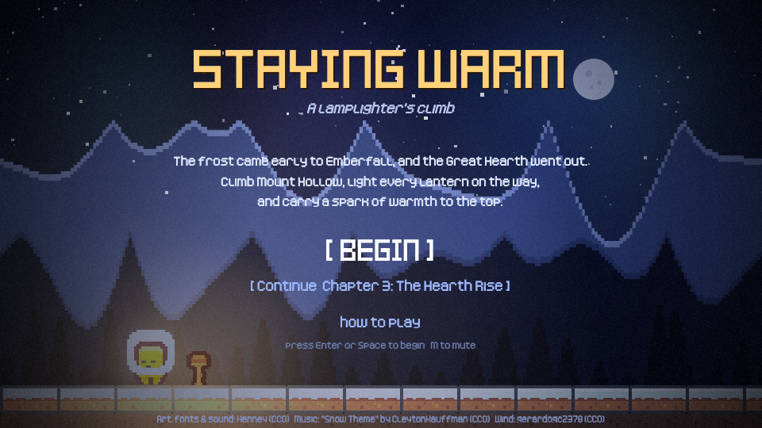
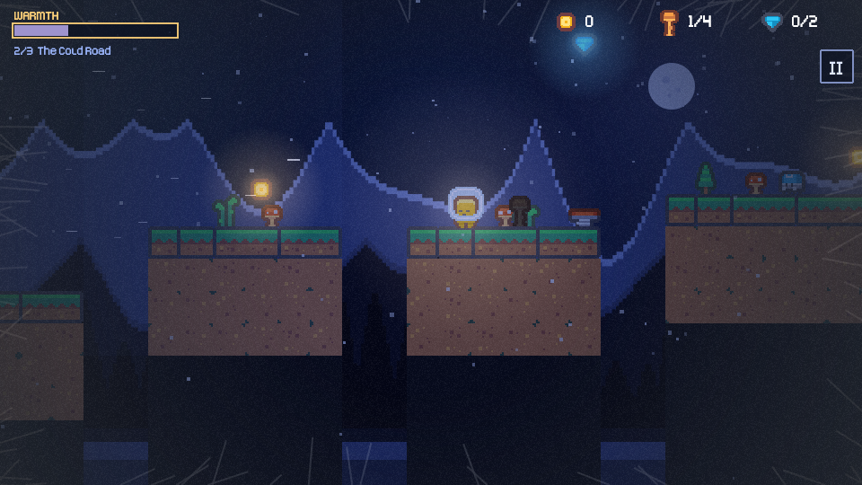
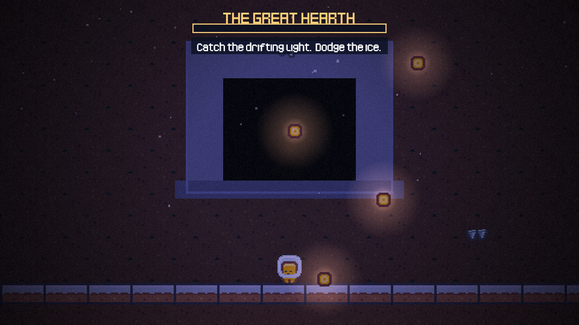

# Staying Warm

    

A short cold-night platformer made for Mini Jam 221 (limitation: "Staying Warm"). Carry sparks up a frozen mountain, light every lantern, and keep your warmth from running out.

  
  
  

Play: A/D or arrows to move, Space/W/Z to jump, Esc or P to pause, M to mute. Touch controls appear on phones and tablets.

## How it plays
Three chapters plus a final stage (about 12 to 17 minutes with the story): The Orchard Path, The Cold Road, The Hearth Rise, and a short ember-catching mini game at the Great Hearth. A title page and prologue set it up, short scenes on the road add story, and an ending closes it.
- Your warmth drains all the time, and faster in cold-wind zones. Standing near a lit lantern refills it. At zero you freeze and wake at the last lantern.
- Sparks (gold coins) light lanterns when you walk up to them. Light every lantern in a chapter and the door at its end opens.
- Land on blue slugs to squash them. Red spikers and bats hurt: hop or wait. Red mushrooms are springs.
- Meet Pip, Moth and Brann on the road for a warm drink and a bit of the story. Seven star shards are hidden above the route.

## Stack and layout
Phaser 3 + TypeScript + Vite. `npm run dev` to play locally, `npm run zip` builds `game.zip` for an itch.io HTML5 upload.

- `src/level.ts`: the three chapters (platform segments, items, enemies, wind zones) and the warmth numbers.
- `src/lib/story.ts`: every line of dialogue. `src/lib/dialog.ts`: the dialogue box.
- `src/scenes/`: Boot (loading), Title (welcome page), Game (a chapter), Hearth (the mini game), End (the ending).
- `src/lib/atmosphere.ts`, `src/lib/scenery.ts`: sky, glow, fog, grain, mountains, stars, moon, drawn by code.
- `public/assets`: art and audio. `third_party/`: the original downloads with their licence files. Credits: `public/CREDITS.txt`.

## Rules followed (Mini Jam 221)
Art and sound are CC0 packs by Kenney and CC0 tracks from OpenGameArt (see credits). Docs in `docs/` are planning notes for a larger mobile version.

## License
Original code and writing: [MIT](LICENSE) © 2026 Shivam Chaurasia. Bundled art and audio are CC0 and keep their own licences (see `public/CREDITS.txt` and `third_party/`).
